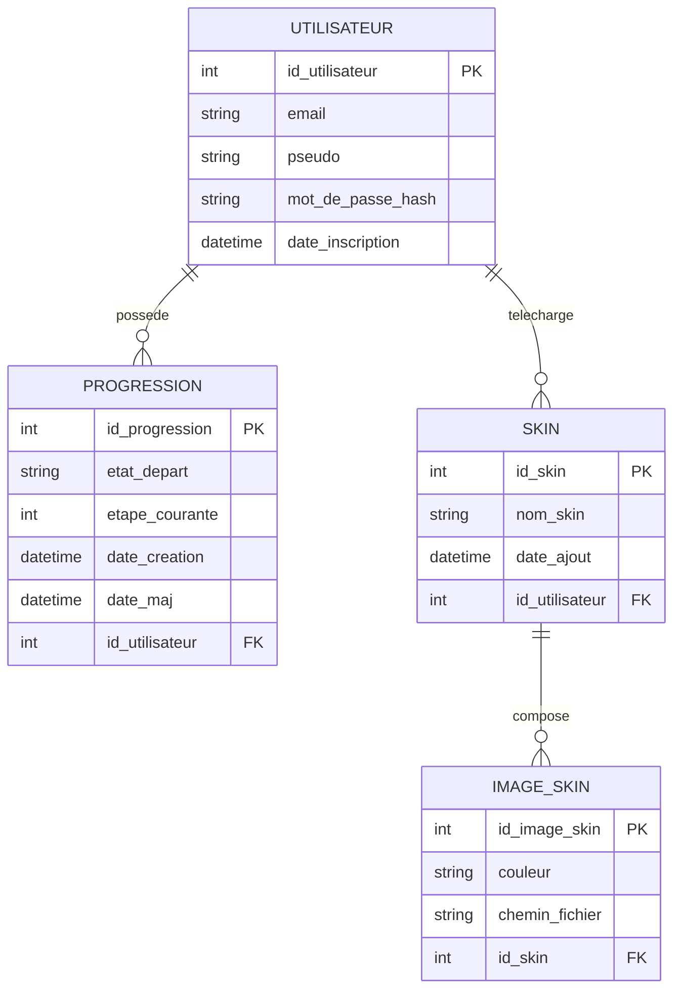

# Modèle conceptuel de données

Schéma complet : voir [05-MCD.svg](05-MCD.svg) — construit à la main dans le
style visuel de Mocodo (le paquet `mocodo` n'est pas installable dans cet
environnement de développement : ni `pip`, ni accès réseau vers PyPI). En
alternative directement lisible sur GitHub/VS Code, un diagramme Mermaid
équivalent est fourni plus bas.

Source Mocodo (texte) : [mocodo-source.mcd](mocodo-source.mcd)

## Entités

- UTILISATEUR
- PROGRESSION
- SKIN
- IMAGE_SKIN

## Relations et cardinalités

- POSSEDER : UTILISATEUR (0,n) — (1,1) PROGRESSION
- TELECHARGER : UTILISATEUR (0,n) — (1,1) SKIN
- COMPOSER : SKIN (0,n) — (1,1) IMAGE_SKIN

## Diagramme Mermaid (équivalent, rendu natif GitHub/VS Code)

