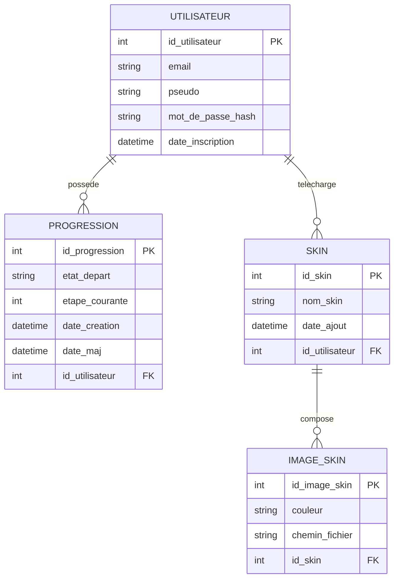

# Modèle de données — Didicecube

Périmètre couvert par la BDD PostgreSQL (cf. `CLAUDE.md`, section
« Architecture retenue ») : **comptes utilisateurs**, **progression de
résolution sauvegardée**, **skins téléchargés**. L'état du cube en cours de
résolution d'un visiteur non connecté reste transitoire (objet JS en
mémoire) et n'entre pas dans ce modèle.

Chaîne de modélisation Merise respectée (section 4 de l'entête de prompt) :
Dictionnaire de données → MCD → MLD → (MPD à venir, une fois validé).

## 1. Dictionnaire de données

| Code | Désignation | Type | Contraintes / règles |
|---|---|---|---|
| `id_utilisateur` | Identifiant de l'utilisateur | Numérique (entier) | Clé primaire, auto-incrémenté |
| `email` | Adresse email de l'utilisateur | Alphanumérique | Unique, non nul, format email |
| `pseudo` | Pseudo affiché | Alphanumérique | Unique, non nul |
| `mot_de_passe_hash` | Hash Argon2 du mot de passe | Alphanumérique | Non nul, jamais exposé au client (cf. section 12) |
| `date_inscription` | Date de création du compte | Date/heure | Non nul, valeur par défaut = date courante |
| `id_progression` | Identifiant d'une progression sauvegardée | Numérique (entier) | Clé primaire, auto-incrémenté |
| `etat_depart` | État de départ du cube (couleur des 54 stickers) | Alphanumérique (chaîne de 54 caractères) | Non nul ; chaque caractère ∈ {`B`,`J`,`R`,`O`,`V`,`L`} (blanc/jaune/rouge/orange/vert/bleu) |
| `etape_courante` | Index du mouvement où l'utilisateur s'est arrêté | Numérique (entier) | Non nul, ≥ 0, par défaut 0 — **non calculée/stockée en plus** : la liste des mouvements est dérivée de `etat_depart` par l'algorithme à chaque affichage, pas dupliquée en base (cf. règle « pas de donnée calculable ») |
| `date_creation` | Date de création de la progression | Date/heure | Non nul, valeur par défaut = date courante |
| `date_maj` | Date de dernière sauvegarde de la progression | Date/heure | Non nul, mise à jour à chaque sauvegarde |
| `id_skin` | Identifiant d'un skin | Numérique (entier) | Clé primaire, auto-incrémenté |
| `nom_skin` | Nom donné au skin par son auteur | Alphanumérique | Non nul |
| `date_ajout` | Date d'ajout du skin | Date/heure | Non nul, valeur par défaut = date courante |
| `id_image_skin` | Identifiant d'une image de skin | Numérique (entier) | Clé primaire, auto-incrémenté |
| `couleur` | Couleur standard remplacée par cette image | Alphanumérique (énumération) | Non nul, ∈ {`B`,`J`,`R`,`O`,`V`,`L`} |
| `chemin_fichier` | Chemin/nom du fichier image stocké sur le serveur | Alphanumérique | Non nul |

**Simplification assumée** : un skin appartient toujours à un utilisateur
(pas de « skins système » partagés pour l'instant — si des skins par défaut
sont ajoutés plus tard, ce sera d'abord comme simples assets statiques du
`client/`, pas en BDD, cf. KISS/YAGNI).

## 2. MCD (Mocodo)

```mocodo
UTILISATEUR: id_utilisateur, email, pseudo, mot_de_passe_hash, date_inscription
POSSEDER, 0N UTILISATEUR, 11 PROGRESSION
PROGRESSION: id_progression, etat_depart, etape_courante, date_creation, date_maj
TELECHARGER, 0N UTILISATEUR, 11 SKIN
SKIN: id_skin, nom_skin, date_ajout
COMPOSER, 11 SKIN, 0N IMAGE_SKIN
IMAGE_SKIN: id_image_skin, couleur, chemin_fichier
```

Rendu visuel du même MCD :



Lecture des cardinalités :
- un **utilisateur** possède **0 à N progressions** ; une **progression**
  appartient à **exactement 1 utilisateur** ;
- un **utilisateur** télécharge **0 à N skins** ; un **skin** appartient à
  **exactement 1 utilisateur** ;
- un **skin** se compose de **0 à N images** (une par couleur remplacée) ;
  une **image de skin** appartient à **exactement 1 skin**.

## 3. MLD (Modèle Logique de Données)

Règles de passage appliquées : chaque entité devient une relation (identifiant
→ clé primaire) ; chaque association 1-N reporte la clé primaire du côté
« 1 » comme clé étrangère du côté « N ».

```
utilisateur (id_utilisateur, email, pseudo, mot_de_passe_hash, date_inscription)

progression (id_progression, etat_depart, etape_courante, date_creation,
             date_maj, #id_utilisateur)

skin (id_skin, nom_skin, date_ajout, #id_utilisateur)

image_skin (id_image_skin, couleur, chemin_fichier, #id_skin)
```

Contrainte complémentaire (à porter au MPD) : `UNIQUE(id_skin, couleur)` sur
`image_skin` — un skin ne peut pas avoir deux images pour la même couleur.

## 4. MPD (Modèle Physique de Données)

*(à faire — prochaine étape : traduction en `CREATE TABLE` PostgreSQL avec
types précis, contraintes `NOT NULL`/`UNIQUE`/`CHECK`/`FOREIGN KEY`.)*
